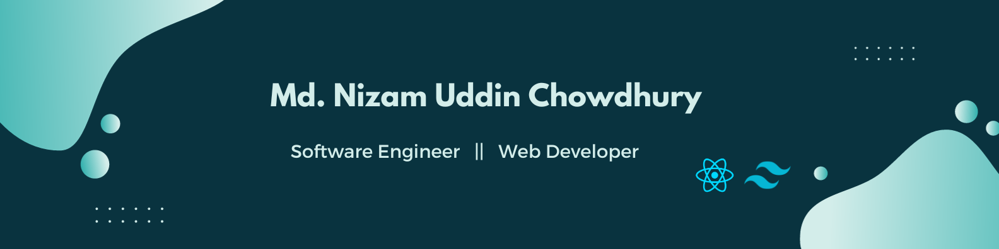

  

<h1 align="center">
  
</h1>

<h3 align="center">Full-Stack Web Developer from Bangladesh, building with TypeScript, Next.js and Node.js</h3>

  
  
  
  
  
  

## About me

- 🔭 I build full-stack web apps with **Next.js, TypeScript, Express and PostgreSQL (Prisma)**
- 🧪 I write tests too: **Vitest + Supertest** for APIs and **Playwright** for end-to-end and automation
- ⚡ Recent work: real-time chat with **Socket.IO**, **Redis** caching and TypeScript monorepos
- 🎨 Lately: scroll-driven animation and 3D on the web with **GSAP ScrollTrigger, Motion, Lenis and React Three Fiber**
- 🤖 AI is part of my daily workflow: **Claude Code** and other AI coding agents for building, reviewing and testing
- 💬 Ask me about **React / Next.js, REST APIs, Prisma, MERN**
- 📫 Reach me at **nizam.chy.cs@gmail.com**

## Tech stack

**Frontend**

  <picture>
    <source media="(prefers-color-scheme: dark)" srcset="https://skillicons.dev/icons?i=ts%2Cjs%2Creact%2Cnextjs%2Credux%2Ctailwind%2Cthreejs%2Chtml%2Ccss%2Cvite&theme=dark" />
    
  </picture>

**Backend and database**

  <picture>
    <source media="(prefers-color-scheme: dark)" srcset="https://skillicons.dev/icons?i=nodejs%2Cexpress%2Cprisma%2Cpostgres%2Cmongodb%2Credis%2Cfirebase&theme=dark" />
    
  </picture>

**Testing, tools and deployment**

  <picture>
    <source media="(prefers-color-scheme: dark)" srcset="https://skillicons.dev/icons?i=vitest%2Cgit%2Cgithub%2Cgithubactions%2Cpostman%2Cvercel%2Cnetlify%2Cfigma%2Cvscode%2Ccpp&theme=dark" />
    
  </picture>

  
  
  
  
  
  
  
  
  
  

**Animation and 3D**

  
  
  
  
  
  

**AI and developer productivity**

  
  
  
  
  

## Featured projects

| Project | What it is | Built with |
| --- | --- | --- |
| [Crunch Lab](https://github.com/NizamChy/crunch-lab) · [live](https://crunch-lab-peach.vercel.app) | Heavily animated chip-brand concept site: 3D falling chips, pinned scroll story, tilt cards, pack builder | Next.js 16, TypeScript, GSAP ScrollTrigger, Motion, Lenis, React Three Fiber |
| [NoTension](https://github.com/NizamChy/notension-main) · [live](https://notension-main.vercel.app) | Multi-service marketplace for Bangladesh: grocery, medicine, food, fashion, doctors and local services | Next.js 16, Redux Toolkit, TanStack Query, Axios, Google Maps API |
| [Dream Craft Events](https://github.com/NizamChy/dream-craft-events-v2) | Event ticketing, party-supply shop and custom event planning, with one-click demo logins | Next.js, Express, Prisma, PostgreSQL, TypeScript |
| [Buddy Script](https://github.com/NizamChy/buddy-script) | Social feed with auth, posts, likes, comments and replies | Next.js, Express, PostgreSQL/Prisma, Redis, Playwright |
| [Nexa Chat](https://github.com/NizamChy/nexa-chat) | Real-time chat app | Next.js, Socket.IO, TanStack Query, TypeScript |
| [Villa of Summer](https://villa-of-summer.netlify.app/) | Villa rental landing page with city search, date and guest pickers | React, Tailwind CSS, DaisyUI |

## GitHub stats

  <picture>
    <source media="(prefers-color-scheme: dark)" srcset="https://github-profile-summary-cards.vercel.app/api/cards/stats?username=NizamChy&theme=github_dark" />
    
  </picture>
  <picture>
    <source media="(prefers-color-scheme: dark)" srcset="https://github-profile-summary-cards.vercel.app/api/cards/repos-per-language?username=NizamChy&theme=github_dark" />
    
  </picture>

  <a href="https://git.io/streak-stats">
    <picture>
      <source media="(prefers-color-scheme: dark)" srcset="https://streak-stats.demolab.com?user=NizamChy&theme=github-dark-blue&hide_border=true" />
      
    </picture>
  </a>

  <picture>
    <source media="(prefers-color-scheme: dark)" srcset="https://raw.githubusercontent.com/NizamChy/NizamChy/output/pacman-contribution-graph-dark.svg" />
    
  </picture>

  

